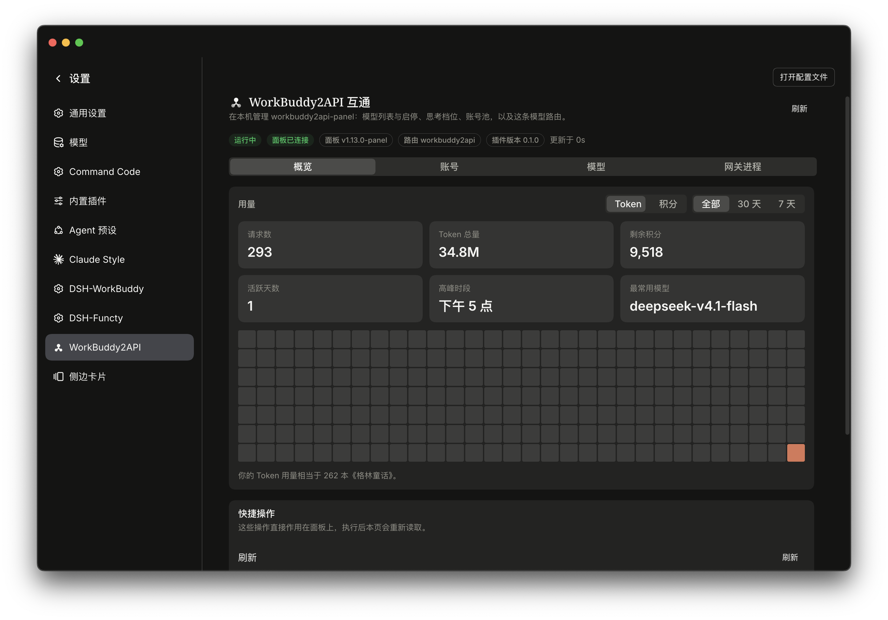
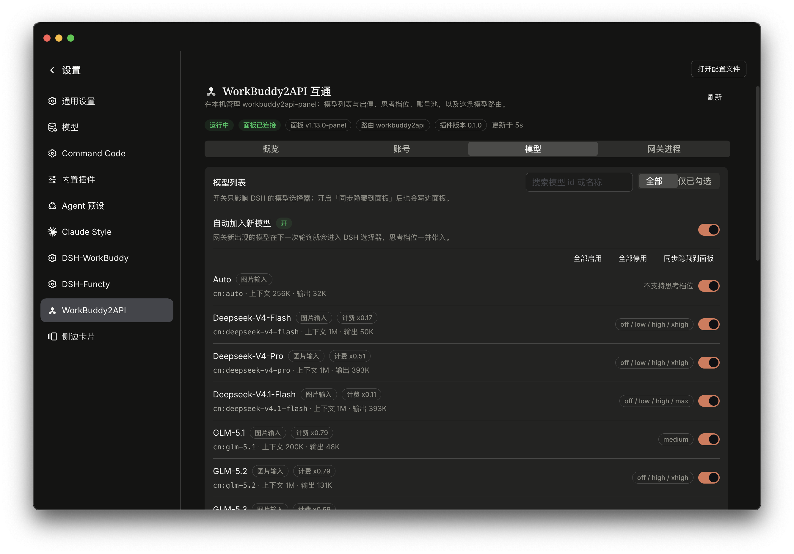
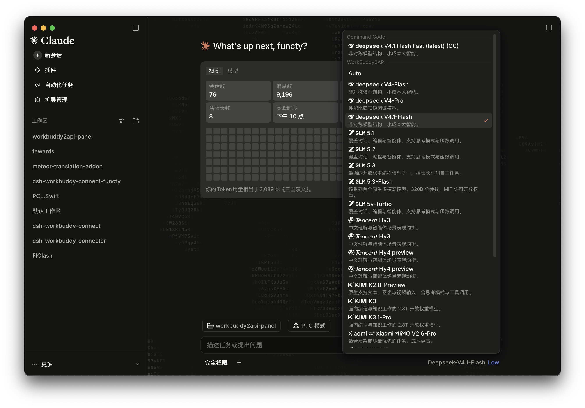

  

<h1 align="center">dsh-workbuddy-panel</h1>

把 <a href="https://github.com/linguo2625469/workbuddy2api-panel">workbuddy2api</a> 网关 <b>托管进 DSH</b>：插件自己发现并拉起上游进程，账号、模型目录、思考档位全部在 DSH 内管理 —— 不需要打开网关的面板网页。

## 它做了什么

- **托管进程**：只运行随包发布的 `bin/workbuddy2api`（不做 PATH 或目录探测）→ 生成完整配置（面板默认 + 随机 API key、loopback 监听）→ 启动 → 崩溃退避重启 → 展示日志。外部已启动的网关照常接管（识别为 `external`，只有"停止"会拒绝）。
- **模型自动发现**：每轮轮询把网关的模型目录与上一份做 diff（新增 / 移除 / 变更），新增模型自动进入 DSH 选择器，思考档位一并带入；读取失败保留上一份目录。
- **稳定排序**：网关的 `/panel/api/models` 是遍历 Go map 得到的，顺序每次可能不同；插件按 `id` 排序，列表不再跳动。
- **账号表格**：对齐面板账号页的列（身份 / 状态 / 积分 + 进度条 / 成功·连败 / 请求·Token / 操作），备注里带冷却原因、限流模型数、凭证到期。
- **登录流程**：列表底部"+ 添加账号"打开弹窗 —— 国内扫码（内置 QR 编码器，无第三方依赖）、国际打开浏览器授权、两域都支持粘贴令牌；账号落地后弹窗自动关闭。
- **思考档位**：模型行只读展示该模型**支持的全部档位**（如 `off / low / high / max`），不在插件里改档位。
- **仅显示已勾选**：模型页可按"仅已勾选"过滤，配合"全部启用 / 全部停用 / 同步隐藏到面板"。
- **输入框额度**：composer dock 显示账号池剩余积分，无框纯文本，与宿主的用量读数同排。
- **图片输入**：provider 接好了 durable attachment 钩子，带图对话不会报 `UNSUPPORTED_CONTENT`。

## 安装

### 前置条件

- DSH（DeepSeek Harness）桌面端，profile 目录一般是 `~/.dsh/profiles/desktop`。
- 用来管理 profile 的 pnpm（DSH 自带运行时里也有）。
- **不需要 Go 工具链**：网关二进制随包发布（`bin/workbuddy2api`）。

### 第一步：装包

npm 包发布后：

    cd ~/.dsh/profiles/desktop
    pnpm add dsh-workbuddy-panel

还没发布、或想用本地源码时，改用链接：

    cd ~/.dsh/profiles/desktop
    pnpm add link:/path/to/dsh-workbuddy-panel

### 第二步：登记到 profile

编辑 `~/.dsh/profiles/desktop/package.json`，把包名加进 `dsh.profile.bundles` 数组末尾：

    "dsh": {
      "profile": {
        "bundles": [
          "@deepseek-ai/dsh-base",
          "@deepseek-ai/dsh-web-app",
          "...",
          "dsh-workbuddy-panel"
        ]
      }
    }

### 第三步：重启 DSH

**⌘Q 完全退出**再打开（关窗口不算）。插件在启动时加载，重启后设置左侧导航会出现 **WorkBuddy2API**，模型选择器里出现 `workbuddy2api` 分组。

### 首次启动会发生什么

1. 在 `~/.dsh/workbuddy2api-gateway/gateway/` 生成网关配置与数据目录。
2. 写出的配置是**面板的完整默认配置**（池策略、熔断/冷却、签到/保活/成长/旅行定时任务、会话粘性、指纹脱敏开关、prompt 透传），只由插件覆盖四个字段：`api_key` / `listen` / `auth_dir` / `state_file`。
3. 若同机已有一份面板配置（例如 `~/Downloads/workbuddy2api-panel/config.json`），会**以它为基底继承**，你自己的池权重、隐藏模型、上游设置都会保留。
4. 启动 `bin/workbuddy2api`，监听 `127.0.0.1:7863`。
5. 设置页顶部变为「运行中 / 面板已连接」。

### 第四步：添加账号

设置 → **WorkBuddy2API** → **账号** → 表格底部 **+ 添加账号**：

- **国内**：选「扫码登录」，弹窗会自动生成二维码，用手机扫码完成授权（也可以复制链接或点「打开登录页」）。
- **国际**：选「国际」，按钮变成「打开登录页」，在浏览器里完成授权。
- **令牌**：切到「令牌登录」，粘贴账号 JSON（面板 cockpit 导出格式，或 `auths/*.json` 的 `{ auth: { accessToken, refreshToken } }`）。

账号落地后弹窗自动关闭，表格里出现新行。

### 第五步：用模型

在模型选择器里选 `workbuddy2api` 分组下的模型即可；网关新出现的模型会在下一次轮询自动加入（可在「模型」页关闭「自动加入新模型」）。

### 迁移已有的面板安装

- 账号目录：把 `authDir` 指到你已有的 `auths/`，或在网关工作目录里做一个软链（`ln -s /path/to/auths ~/.dsh/workbuddy2api-gateway/gateway/auths`）。
- 如果那个面板进程还占着 `:7863`，插件会把它识别为 **external**：状态、目录、账号操作照常，只有「停止」会提示"不是本插件拉起的"。

### 装不上时先看这里

| 现象 | 原因 | 处理 |
| --- | --- | --- |
| 设置里没有 WorkBuddy2API | 没有重启 DSH，或 bundles 里没加包名 | ⌘Q 重启；核对 package.json |
| 网关「启动失败」 | 包内 `bin/workbuddy2api` 缺失（例如手工裁剪过目录） | 重新安装，或在仓库里 `git checkout bin/` |
| 面板未连接 / 401 | 设置页里的密钥与网关 config.json 不一致 | 在「网关进程」分区重新保存一次密钥（插件会写回 config 并重启网关） |
| 端口被占用 | 另一份网关已在运行 | 会显示为 external；要换端口就改 `port` 后再启动 |
| 模型列表为空 | 网关没有可用账号 | 先在「账号」页添加账号 |

## 配置

| 字段 | 默认 | 说明 |
|---|---|---|
| `providerId` | `workbuddy2api` | 模型路由 id（选择器里的分组名） |
| `displayName` | `WorkBuddy2API` | 分组显示名 |
| `port` | `7863` | 网关监听端口 / 健康探测端口 |
| `autoStart` | `true` | 随插件启动，崩溃后退避重启 |
| `restartLimit` | `5` | 一轮运行内允许的重启次数 |
| `refreshSeconds` | `15` | 目录轮询间隔 |
| `apiKey` | `''` | 网关密钥；空 = 用（或生成）网关 config.json 里的 key |
| `authDir` | `''` | 账号目录；空 = `<workdir>/auths` |
| `autoRegister` | `true` | 新模型自动进入选择器 |

**密钥只有一个**：在设置页改密钥时，插件会把它写进网关的 `config.json` 并重启网关，避免"插件连不上、面板网页也进不去"。

## 架构

| 文件 | 职责 |
|---|---|
| `src/supervisor.ts` | 二进制发现、config 生成、spawn、SIGTERM/SIGKILL、退避重启、日志环、`/healthz` 探测 |
| `src/service.ts` | 状态聚合：网关读取、目录 diff、账号操作、登录流程、用量缓存 |
| `src/routes.ts` | 两个 loopback 路由：`status`（只读，带 controlKey）与 `action`（controlKey 保护） |
| `src/adapter.ts` | pi-ai provider：指向网关 `/v1`，带 attachment 钩子 |
| `src/catalog.ts` | 目录合并 + 本地覆盖（显示/隐藏、档位）+ **按 id 排序** |
| `src/usage.ts` | 读网关用量账本，按天聚合出热力图窗口、高峰时段、最常用模型 |
| `src/client/*` | DSH 原生 UI：设置页四分区、账号表格、添加账号弹窗、用量卡、composer 额度 |

## 开发

    pnpm install
    pnpm run build       # tsdown：ESM host + CJS client
    pnpm run typecheck   # tsconfig.json + tsconfig.client.json
    pnpm run test        # vitest：supervisor / service / client-render

## 已知边界

- 路由前缀仍是 `/plugins/workbuddy2api-gateway/*`（改名只动了包名与显示名，避免已有安装的链接与缓存失效）。
- 设置左侧导航的图标由宿主的 `navIcon(id)` 白名单决定，插件没有 icon 位；本插件给那一行打 `data-wb2a-nav` 标记后用遮罩画出自己的图形。
- 网关的登录、签到、限流策略属于网关本身，插件只驱动、不重写。

## 鸣谢

- **[workbuddy2api-panel](https://github.com/linguo2625469/workbuddy2api-panel)**（[Sliverkiss/workbuddy2api](https://github.com/Sliverkiss/workbuddy2api) 的 fork）— 本项目托管的网关本体。账号池轮转、熔断与冷却、会话粘性、签到 / 活跃 / 旅行 / 保活、OAuth 登录、OpenAI 兼容层全部来自它。MIT 许可，版权归 Sliverkiss 与 linguo2625469 所有。
- 本仓库在 upstream/workbuddy2api-panel/ 保存的是**本机工作树的源码快照**：它就是 `bin/workbuddy2api` 的编译来源，包含本地对上游的全部修改（复制时有 47 个文件与上游最后一次提交不同），因此"插件跑的那份二进制"和"仓库里那棵源码树"是对得上的，可以直接核对插件调用的 HTTP 契约。Git 历史未包含，见 `upstream/workbuddy2api-panel/BUILD-NOTES.md`。npm 发布包**只带二进制** `bin/workbuddy2api`，不含源码；插件本身不链接上游代码，只通过 HTTP API 读写账号与模型。默认配置模板取自该安装的 `config.json`（见 `src/default-config.ts`），字段结构归上游。
- 上游仓库目前带有**停止维护声明**，并禁止未授权的反代 / 转卖；使用前请自行确认所在环境的条款。
- UI 与交互参考了插件 [dsh-workbuddy-connect-functy](https://github.com/functy23) 的实现（账号行、添加账号弹窗、composer 额度徽章）；视觉语言参考插件 **dsh-claude-style**（Claude Style 主题插件）的设计。

## License

MIT
